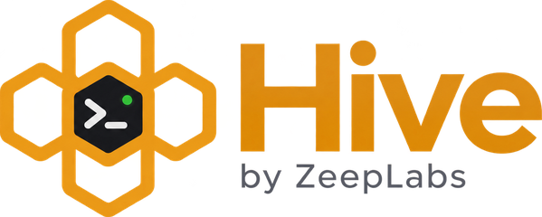

<picture>
  <source media="(prefers-color-scheme: dark)" srcset=".github/assets/logo-dark.png">
  
</picture>

**A lightweight native Mac app to organize your projects and run AI coding agents in terminals — with a separate identity for each organization.**

[🇧🇷 Português](README.pt-BR.md) · **English**

[**⬇️ Download the latest version**](../../releases/latest)

<!-- Screenshots: add images to a `screenshots/` folder and reference them here, for example:

-->

## What is Hive?

If you run several AI agents (Claude Code, Codex, opencode) in parallel and work for more than one organization, a flat list of terminals mixes everything up. **Hive keeps your projects in a tree and runs each session with the identity of the organization that owns the project**: the right git author, SSH key, GitHub CLI account and agent settings.

It is a **native Mac app** (no Electron), made to stay light while several terminals are open.

## Features

- 🌳 **Project tree** — organization, nested groups, projects and git worktrees, with drag and drop, multi-selection and quick search.
- 🖥️ **Terminals** — tabs and splits per project; the layout comes back when you reopen the app.
- 🤖 **Agents in one click** — Shell, Claude Code, Codex and opencode, with a configurable command.
- 🪪 **Identity per organization** — git author, SSH key, GitHub CLI and agent settings applied to every session. Secret values live in the macOS Keychain.
- 🚦 **Agent status** — running, waiting for you or finished, in the tree and the tabs, with notifications.
- 📥 **Import by scan** — find the git repositories in a folder and review them before adding.
- 📊 **Resources** — CPU, memory, disk and process count for each session.

The interface is in Portuguese.

## Download and install

1. Open [**Releases**](../../releases/latest) and download the `.dmg` file.
2. Open it and **drag Hive to Applications**.
3. Open Hive from Launchpad or Spotlight.

The app is **signed and notarized by Apple**. The `SHA-256` of each file is in the release notes if you want to check your download.

**Requirements:** macOS 14 Sonoma or later.

## Updates

Hive **updates itself**: when a new version is out, it tells you and you choose whether to install it. On the second launch it asks whether it may check automatically; if you allow it, it checks this project's update feed once a day, which reveals your IP address and the app version to the host (GitHub). Nothing else is sent. Every update is verified with a cryptographic signature before it is installed.

The update check is the only network request Hive itself makes. Your agents, git and anything else you run in the terminals connect on their own, as they would in any terminal.

## Feedback and bugs

Open an [issue](../../issues) in this repository. **Never include tokens, SSH keys, API keys or other secrets** in an issue, and check terminal output for them before pasting it.

## About

This repository only holds the published versions and the update feed. The source code is not public.

© Zeep Labs. All rights reserved.
