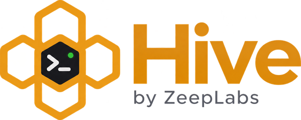
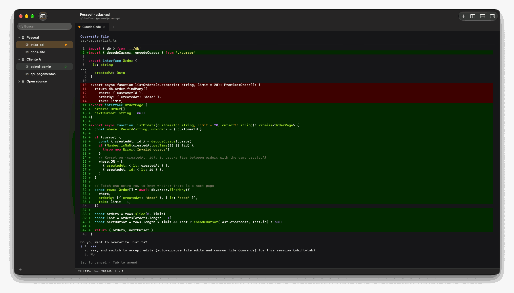

<picture>
  <source media="(prefers-color-scheme: dark)" srcset=".github/assets/logo-dark.png">
  
</picture>

**Um app nativo e leve para Mac que organiza seus projetos e roda agentes de IA de código em terminais — com uma identidade separada para cada organização.**

**🇧🇷 Português** · [English](README.md)

[**⬇️ Baixar a versão mais recente**](../../releases/latest)

  

## O que é o Hive?

Se você roda vários agentes de IA (Claude Code, Codex, opencode) em paralelo e trabalha para mais de uma organização, uma lista solta de terminais mistura tudo. **O Hive mantém seus projetos numa árvore e roda cada sessão com a identidade da organização dona do projeto**: o autor git, a chave SSH, a conta do GitHub CLI e os ajustes de agente certos.

É um **app nativo de Mac** (sem Electron), feito para continuar leve com vários terminais abertos.

## Recursos

- 🌳 **Árvore de projetos** — organização, grupos aninhados, projetos e worktrees git, com arrastar e soltar, seleção múltipla e busca rápida.
- 🖥️ **Terminais** — abas e divisões por projeto; o layout volta quando você reabre o app.
- 🤖 **Agentes em um clique** — Shell, Claude Code, Codex e opencode, com comando configurável.
- 🪪 **Identidade por organização** — autor git, chave SSH, GitHub CLI e ajustes de agente aplicados a cada sessão. Valores secretos ficam no Keychain do macOS.
- 🚦 **Status dos agentes** — rodando, esperando você ou concluído, na árvore e nas abas, com notificações.
- 📥 **Importar por varredura** — encontra os repositórios git de uma pasta para você revisar antes de adicionar.
- 📊 **Recursos** — CPU, memória, disco e número de processos de cada sessão.

A interface é em português.

## Baixar e instalar

1. Abra [**Releases**](../../releases/latest) e baixe o arquivo `.dmg`.
2. Abra o arquivo e **arraste o Hive para Aplicativos**.
3. Abra o Hive pelo Launchpad ou pelo Spotlight.

O app é **assinado e notarizado pela Apple**. O `SHA-256` de cada arquivo está nas notas da versão, se você quiser conferir o download.

**Requisitos:** macOS 14 Sonoma ou posterior.

## Atualizações

O Hive **se atualiza sozinho**: quando sai uma versão nova, ele avisa e você escolhe se quer instalar. Na segunda abertura ele pergunta se pode procurar atualizações automaticamente; se você permitir, ele consulta o feed de atualizações deste projeto uma vez por dia, o que revela seu endereço IP e a versão do app ao host (GitHub). Nada além disso é enviado. Toda atualização é conferida com uma assinatura criptográfica antes de ser instalada.

A verificação de atualizações é a única requisição de rede feita pelo próprio Hive. Seus agentes, o git e o que mais você rodar nos terminais se conectam por conta própria, como em qualquer terminal.

## Sugestões e bugs

Abra uma [issue](../../issues) neste repositório. **Nunca inclua tokens, chaves SSH, chaves de API ou outros segredos** numa issue, e confira a saída do terminal antes de colar.

## Sobre

Este repositório guarda só as versões publicadas e o feed de atualizações. O código-fonte não é público.

© Zeep Labs. Todos os direitos reservados.
